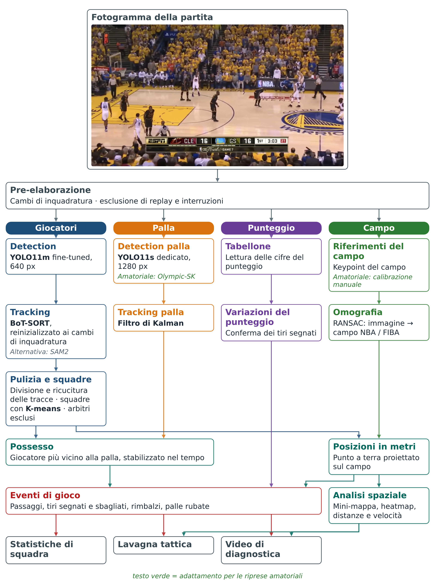

# Basketball Video Analysis with Computer Vision

### Tesi di Laurea Magistrale in Ingegneria Informatica

**Università degli Studi Roma Tre**  
**Autore:** Marco D'Albis  
**Relatore:** Prof. Giuseppe Sansonetti  
**Anno accademico:** 2025/2026

---

## Descrizione

Sistema di analisi automatica delle partite di basket basato su **Computer Vision e Deep Learning**, sviluppato per rilevare e tracciare i giocatori, ricostruirne le posizioni sul campo e riconoscere eventi di gioco a partire da riprese video.

Il progetto integra modelli di Object Detection, algoritmi di Multi-Object Tracking, segmentazione video, trasformazioni geometriche e regole temporali.

L'analisi è stata sviluppata principalmente su riprese televisive NBA e successivamente sperimentata su video di partite dilettantistiche con differenti condizioni di acquisizione.

L'obiettivo è studiare la possibilità di ottenere informazioni spaziali e statistiche da riprese monocamera, senza richiedere infrastrutture professionali di tracking.

Il sistema è un **prototipo sperimentale**, non un prodotto destinato all'utilizzo professionale.

---

## Indice

1. [Panoramica](#1-panoramica)
2. [Architettura del sistema](#2-architettura-del-sistema)
3. [Funzionalità](#3-funzionalità)
4. [Risultati sperimentali](#4-risultati-sperimentali)
5. [Struttura del progetto](#5-struttura-del-progetto)
6. [Notebook](#6-notebook)
7. [Dataset e modelli](#7-dataset-e-modelli)
8. [Installazione ed esecuzione](#8-installazione-ed-esecuzione)
9. [Problemi tecnici noti](#9-problemi-tecnici-noti)
10. [Limitazioni](#10-limitazioni)
11. [Sviluppi futuri](#11-sviluppi-futuri)
12. [Tecnologie e riferimenti](#12-tecnologie-e-riferimenti)

---

## 1. Panoramica

La pipeline affronta cinque problemi principali:

- **Player Detection:** individuazione dei giocatori nei fotogrammi.
- **Multi-Object Tracking:** associazione temporale delle rilevazioni e mantenimento delle identità.
- **Court Localization:** ricostruzione delle posizioni su un campo bidimensionale tramite omografia.
- **Spatial Analytics:** classificazione delle squadre, traiettorie, heatmap e statistiche di movimento.
- **Event Recognition:** riconoscimento di tiri, canestri, passaggi, rimbalzi, palle rubate e rimesse.

Sono state confrontate differenti architetture e configurazioni per valutarne accuratezza, robustezza e costo computazionale.

La struttura è modulare: i componenti di detection, tracking e localizzazione possono essere sostituiti e valutati separatamente.

### Obiettivi del progetto

- Analizzare video di basket attraverso tecniche di Computer Vision.
- Confrontare detector e algoritmi di tracking.
- Ricostruire le posizioni dei giocatori sul campo.
- Generare rappresentazioni tattiche e statistiche spaziali.
- Riconoscere automaticamente alcuni eventi di gioco.
- Studiare la trasferibilità del sistema dalle riprese NBA ai video dilettantistici.
- Individuare le principali fonti di errore e i limiti delle tecniche utilizzate.

---

## 2. Architettura del sistema

La pipeline integra diversi moduli di elaborazione, organizzati in modo da utilizzare le informazioni visive per ricostruire le traiettorie e analizzare gli eventi di gioco.

### Schema generale della pipeline



*Architettura generale del sistema di analisi video del basket, con i principali moduli di elaborazione e gli adattamenti per le riprese amatoriali.*

### Object Detection

Per il rilevamento dei giocatori sono state valutate diverse architetture:

- YOLO11n
- YOLO11s
- YOLO11m
- RT-DETR-L

Sono stati confrontati modelli preaddestrati e modelli sottoposti a fine-tuning su dataset specifici del basket.

Per il rilevamento della palla è stato sviluppato un detector dedicato **YOLO11s**, addestrato e valutato anche a una risoluzione di ingresso di 1280 pixel.

### Multi-Object Tracking

Sono stati confrontati cinque algoritmi tracking-by-detection:

- SORT
- ByteTrack
- OC-SORT
- BoT-SORT
- C-BIoU

È stata inoltre sviluppata una configurazione basata su **SAM2.1 Hiera Large**, che utilizza la propagazione temporale delle maschere.

Per SAM2 è stata implementata una strategia di **ri-detection periodica**, finalizzata a introdurre giocatori non presenti nel fotogramma iniziale e a migliorare la copertura delle tracce.

### Ricostruzione spaziale

Le posizioni dei giocatori vengono trasformate dal sistema di coordinate dell'immagine a quello del campo attraverso:

1. Rilevamento di 33 keypoint del terreno di gioco.
2. Stima dell'omografia mediante RANSAC.
3. Individuazione di un punto rappresentativo del contatto con il terreno.
4. Proiezione sul campo bidimensionale.
5. Filtraggio temporale delle coordinate.

Le coordinate ricostruite vengono utilizzate per generare visualizzazioni tattiche e statistiche di movimento.

### Riconoscimento degli eventi

Il modulo eventi utilizza le informazioni prodotte da:

- Detection e tracking dei giocatori.
- Detection e tracking della palla.
- Stima del possesso.
- Analisi delle variazioni del punteggio.
- Rilevamento dei cambi di inquadratura.
- Regole temporali.

L'integrazione di queste informazioni permette di individuare alcune tipologie di azione e costruire una timeline degli eventi riconosciuti.

---

## 3. Funzionalità

### 3.1 Rilevamento e tracking dei giocatori

Il sistema associa a ciascun giocatore un identificativo temporale per ricostruirne la traiettoria.

Sono presenti procedure di post-processing per:

- Interpolare brevi interruzioni delle tracce.
- Individuare rilevazioni duplicate.
- Escludere posizioni non affidabili.
- Segnalare possibili scambi di identità tra giocatori di squadre differenti.

Le occlusioni e i cambi di inquadratura possono comunque determinare frammentazioni e scambi di identità.

### 3.2 Classificazione delle squadre

La classificazione utilizza le caratteristiche cromatiche delle divise.

Le informazioni vengono estratte dalla regione del busto e rappresentate mediante istogrammi nello spazio colore Lab.

Le osservazioni vengono aggregate per traccia e raggruppate attraverso **K-means con due cluster**.

Un controllo temporale consente inoltre di individuare cambiamenti persistenti del colore associato a una traccia, potenzialmente causati da scambi di identità.

### 3.3 Mappa bidimensionale

I giocatori vengono rappresentati su un campo NBA osservato dall'alto.

La visualizzazione comprende:

- Posizioni aggiornate nel tempo.
- Squadra di appartenenza.
- Identificativi dei giocatori.
- Traiettorie ricostruite.
- Confronto sincronizzato con il video originale.

### 3.4 Heatmap

Le coordinate dei giocatori vengono aggregate spazialmente per individuare le aree maggiormente occupate.

Le heatmap possono essere generate per singolo giocatore o per squadra.

Nella demo vengono utilizzati istogrammi bidimensionali, filtraggio gaussiano e normalizzazione per squadra.

### 3.5 Distanze e velocità

Le coordinate proiettate sul campo consentono di stimare:

- Distanza percorsa.
- Velocità media.
- Velocità massima su intervalli temporali.
- Traiettorie individuali.

Per ridurre l'influenza degli errori di localizzazione vengono applicati filtri temporali e controlli sugli spostamenti anomali.

**Nota:** queste statistiche sono indicative e non sono state validate rispetto a misurazioni indipendenti o dati ufficiali di tracking.

### 3.6 Riconoscimento degli eventi

Gli eventi considerati comprendono:

- Passaggi.
- Tiri.
- Canestri.
- Rimbalzi.
- Palle rubate.
- Rimesse.

Il riconoscimento si basa su regole temporali e sulle relazioni tra posizione della palla, giocatori e possesso.

### 3.7 Lavagna tattica

La lavagna tattica rappresenta gli eventi su un campo bidimensionale.

Sono disponibili due modalità:

- **Automatica:** gli eventi vengono generati dalla pipeline.
- **Manuale:** gli eventi vengono letti da un file CSV e associati alle coordinate ricostruite.

Sono inoltre disponibili video diagnostici, timeline del possesso e riepiloghi statistici.

---

## 4. Risultati sperimentali

Gli esperimenti sono stati organizzati per valutare separatamente le principali componenti della pipeline.

I risultati riportati si riferiscono ai dataset, alle configurazioni e ai protocolli specifici descritti nella tesi.

### E1 — Confronto dei detector

I modelli sono stati valutati sul test set di Roboflow Basketball Player Detection v18 e su sequenze di basket di SportsMOT.

| Modello | AP50:95 Roboflow | AP50:95 SportsMOT | FPS T4 |
|---|---:|---:|---:|
| YOLO11n fine-tuned | 0.754 | 0.625 | 88.6 |
| YOLO11s fine-tuned | 0.796 | 0.641 | 79.9 |
| **YOLO11m fine-tuned** | **0.830** | 0.662 | 51.7 |
| **RT-DETR-L fine-tuned** | 0.823 | **0.708** | 14.6 |
| YOLO11s COCO | 0.486 | 0.547 | 75.9 |

**Osservazioni principali:**

- Il fine-tuning migliora le prestazioni sul dataset Roboflow.
- YOLO11m raggiunge la migliore AP50:95 sul test Roboflow.
- RT-DETR-L ottiene il risultato migliore sul test SportsMOT.
- YOLO11m offre un compromesso favorevole tra accuratezza e costo computazionale.

Le misure FPS sono riferite alle specifiche configurazioni sperimentali utilizzate su GPU NVIDIA T4.

### E2 — Multi-Object Tracking

La valutazione tracking-by-detection utilizza 15 sequenze di basket SportsMOT, per un totale di 12.557 fotogrammi.

| Detector + Tracker | HOTA | MOTA | IDF1 |
|---|---:|---:|---:|
| **RT-DETR-L + BoT-SORT** | **0.539** | 0.898 | **0.571** |
| RT-DETR-L + C-BIoU | 0.521 | 0.894 | 0.558 |
| YOLO11m + BoT-SORT | 0.518 | 0.905 | 0.557 |
| YOLO11s COCO + BoT-SORT | 0.381 | 0.620 | 0.387 |

RT-DETR-L con BoT-SORT ottiene la migliore HOTA e IDF1 tra le configurazioni riportate.

#### Confronto con SAM2

Per confrontare i tracker tradizionali con SAM2, la valutazione è stata ripetuta sui primi 300 fotogrammi delle 15 sequenze.

| Metodo | HOTA | AssA | IDF1 | ID Switch |
|---|---:|---:|---:|---:|
| **SAM2 + ri-detection** | **0.734** | 0.785 | **0.854** | 65 |
| SAM2 solo frame iniziale | 0.713 | **0.796** | 0.827 | **54** |
| RT-DETR-L + BoT-SORT | 0.676 | 0.611 | 0.775 | 249 |
| YOLO11m + BoT-SORT | 0.654 | 0.574 | 0.766 | 244 |

SAM2 ottiene risultati migliori nelle metriche di tracking considerate sul sottoinsieme valutato, ma presenta un costo computazionale elevato.

La configurazione con ri-detection raggiunge circa **1,4 FPS su GPU NVIDIA L4**.

Rispetto all'inizializzazione esclusiva nel primo fotogramma, la ri-detection migliora la HOTA di 0.021, pur aumentando il numero di ID switch.

I risultati non devono essere confrontati direttamente con quelli della tabella precedente, poiché i protocolli utilizzano quantità differenti di fotogrammi.

### E2b — Tracking con addestramento in-domain

È stato valutato anche un YOLO11m addestrato sul training set di SportsMOT.

| Tracker | YOLO11m Roboflow | YOLO11m SportsMOT |
|---|---:|---:|
| SORT | 0.420 | 0.486 |
| ByteTrack | 0.475 | 0.562 |
| OC-SORT | 0.454 | 0.562 |
| BoT-SORT | 0.518 | 0.611 |
| C-BIoU | 0.494 | **0.615** |

*Valori HOTA.*

L'addestramento sui dati SportsMOT migliora le prestazioni per tutti gli algoritmi considerati.

Il confronto evidenzia l'importanza del dominio di addestramento, pur non isolandone completamente l'effetto dalle altre differenze tra le configurazioni di training.

### E3 — Localizzazione e correzione delle coordinate

La valutazione è stata effettuata su punti di contatto con il terreno annotati manualmente in sequenze NBA.

| Metodo | Copertura | RMSE |
|---|---:|---:|
| SAM2 solo frame iniziale | 0.923 | 17.13 px |
| **SAM2 + ri-detection** | **0.945** | **14.31 px** |
| SAM2 + ri-detection + correttore temporale | 0.934 | 15.50 px |

La ri-detection migliora la copertura e riduce l'errore di localizzazione nel test considerato.

Il correttore temporale basato sull'altezza delle bounding box non produce invece un miglioramento dell'accuratezza in questa valutazione.

### E4 — Rilevamento della palla

È stato addestrato un detector YOLO11s dedicato alla palla, utilizzando dati Roboflow e fotogrammi NBA annotati manualmente.

| Modello | AP50 | AP50:95 | Recall | FPS |
|---|---:|---:|---:|---:|
| COCO sports ball | 0.095 | 0.066 | 0.024 | 40.6 |
| Detector multi-classe, 640 px | 0.508 | 0.257 | 0.470 | 49.2 |
| Detector multi-classe, 1280 px | 0.409 | 0.313 | 0.458 | 41.0 |
| **Detector dedicato, 1280 px** | **0.768** | **0.485** | **0.675** | **56.3** |

Il detector dedicato migliora sensibilmente il rilevamento della palla sul test NBA considerato.

Il test utilizza fotogrammi temporalmente separati, ma provenienti dalla stessa partita impiegata per la preparazione dei dati di addestramento.

### Riconoscimento degli eventi

Le regole sono state valutate confrontando gli eventi riconosciuti automaticamente con annotazioni manuali.

L'associazione considera la tipologia dell'evento e una tolleranza temporale di un secondo.

| Configurazione | Precision | Recall | F1 |
|---|---:|---:|---:|
| Sviluppo, regole v3 | 0.90 | 0.65 | **0.75** |
| **Test cieco, regole v3** | 0.69 | 0.39 | **0.50** |
| Revisione v4 dopo il test | 0.67 | 0.43 | 0.53 |

Il test cieco utilizza sequenze non impiegate per lo sviluppo delle regole.

La revisione v4 è stata realizzata dopo l'analisi degli errori sul test e viene riportata separatamente.

Le principali difficoltà riguardano:

- Rilevamento incompleto della palla.
- Errori nella stima del possesso.
- Cambi di inquadratura non riconosciuti o rilevati erroneamente.
- Propagazione degli errori dalle fasi precedenti.

### Applicazione a riprese dilettantistiche

La pipeline è stata applicata a due differenti scenari amatoriali.

#### DR3 Pomezia – Aprilia

- Ripresa fissa grandangolare a 854×480 pixel.
- Calibrazione manuale con correzione della distorsione.
- Valutazione del rilevamento dei giocatori.
- Analisi dei limiti dovuti alla bassa risoluzione.
- Ricostruzione e ricucitura delle tracce.

Il rilevamento della palla risulta particolarmente difficile a causa delle dimensioni ridotte dell'oggetto nell'immagine.

#### Frosinone – Pomezia

- Ripresa con telecamera automatica a 1280×720 pixel.
- Analisi delle variazioni dell'inquadratura.
- Calibrazione manuale con propagazione temporale.
- Valutazione di un detector alternativo per il pallone FIBA.
- Riconoscimento di eventi di gioco.

Il detector alternativo della palla migliora l'F1 degli eventi da **0.33 a 0.56** sulla sequenza valutata.

Questi risultati hanno carattere esplorativo e dipendono dalle condizioni specifiche delle riprese considerate.

---

## 5. Struttura del progetto

La struttura principale del repository è riassunta di seguito.

```text
tesi-basket/
|
|-- assets/
|   `-- pipeline.png
|
|-- notebooks/
|   |-- 09_genera_tracce_SAM2_7clip
|   |-- 10_E1_detection_confronto
|   |-- 11_E2_tracking_confronto
|   |-- 12_E3_correzione_coordinate
|   |-- 13_demo_squadre_mappa2D
|   |-- 14_eventi_lavagna2D
|   |-- 15_eventi_nba_v3
|   |-- 15_eventi_nba_v4
|   |-- 16_E4_detector_palla
|   |-- 17_estrai_clip
|   |-- 18_E2b_tracking_indomain
|   |-- 19_amatoriali_FIBA
|   `-- 20_DR3_camera_fissa
|
|-- scripts/
|   |-- height_corrector.py
|   |-- court_evaluation.py
|   |-- thesis_tools.py
|   |-- annotate.py
|   `-- run_batch.py
|
|-- annotations/
|   |-- annotations.csv
|   |-- tasks.csv
|   |-- manifest*.csv
|   |-- eventi_manuali.csv
|   `-- eventi_manuali_amatoriali.csv
|
|-- experiments/
|   |-- E1_detection/
|   |-- E2_tracking/
|   |-- E3_correzione/
|   `-- E4_ball/
|
|-- events/
|-- events_nba/
|-- events_amatoriali/
|-- configs/
|-- requirements.txt
`-- README.md
```

La cartella `assets/` è prevista per le immagini utilizzate nella documentazione e deve essere creata se non ancora presente.

I file video, i pesi dei modelli e gli output di grandi dimensioni non sono inclusi nel repository.

La struttura mostrata riassume i componenti principali. Alcuni notebook possono essere disponibili in più versioni o in sottocartelle dedicate alle esecuzioni.

---

## 6. Notebook

| Notebook | Descrizione |
|---|---|
| `09_genera_tracce_SAM2_7clip` | Generazione delle tracce e delle omografie sulle clip NBA |
| `10_E1_detection_confronto` | Addestramento e valutazione dei detector |
| `11_E2_tracking_confronto` | Confronto dei tracker e valutazione di SAM2 |
| `12_E3_correzione_coordinate` | Valutazione della localizzazione e delle correzioni temporali |
| `13_demo_squadre_mappa2D` | Classificazione squadre, mappa 2D, heatmap e statistiche |
| `14_eventi_lavagna2D` | Prima implementazione del modulo eventi |
| `15_eventi_nba_v3` | Riconoscimento degli eventi con regole v3 |
| `15_eventi_nba_v4` | Revisione delle regole e analisi degli errori |
| `16_E4_detector_palla` | Addestramento e confronto dei detector della palla |
| `17_estrai_clip` | Estrazione e preparazione delle sequenze video |
| `18_E2b_tracking_indomain` | Tracking con detector addestrato su SportsMOT |
| `19_amatoriali_FIBA` | Analisi della ripresa con telecamera automatica |
| `20_DR3_camera_fissa` | Analisi della ripresa grandangolare fissa |

I notebook sono stati sviluppati principalmente per l'esecuzione in ambienti Jupyter e Google Colab.

Alcune procedure di valutazione e post-processing possono essere eseguite anche localmente.

**Nota sulla riproducibilità:** diversi notebook dipendono da file intermedi, dataset, modelli addestrati e percorsi configurati durante lo sviluppo. Non tutti gli esperimenti possono essere eseguiti direttamente dopo la sola clonazione del repository.

---

## 7. Dataset e modelli

### Dataset

| Dataset | Utilizzo |
|---|---|
| Basketball Player Detection v18 | Fine-tuning e valutazione dei detector |
| SportsMOT | Addestramento e valutazione del Multi-Object Tracking |
| Clip NBA annotate | Valutazione della localizzazione e test applicativi |
| NBA Finals 2016 | Rilevamento della palla e riconoscimento degli eventi |
| Riprese amatoriali | Valutazione in condizioni di acquisizione differenti |

### Modelli principali

**Detection giocatori**

- YOLO11n/s/m
- RT-DETR-L

**Tracking**

- SORT
- ByteTrack
- OC-SORT
- BoT-SORT
- C-BIoU
- SAM2.1 Hiera Large

**Detection della palla**

- YOLO11s dedicato
- Modelli alternativi per il pallone FIBA

**Court Detection**

- Modello di rilevamento dei keypoint del campo.
- Omografia mediante RANSAC.

### Risorse esterne

- [SportsMOT](https://github.com/MCG-NJU/SportsMOT)
- [Ultralytics](https://github.com/ultralytics/ultralytics)
- [SAM2](https://github.com/facebookresearch/sam2)
- [Roboflow](https://roboflow.com/)
- [OpenCV](https://opencv.org/)

Alcuni dataset e modelli richiedono il download dalle rispettive piattaforme e l'accettazione delle relative condizioni d'uso.

---

## 8. Installazione ed esecuzione

### Requisiti

- Python 3.
- Ambiente Jupyter o Google Colab.
- GPU NVIDIA consigliata per detection, tracking e segmentazione.
- Dipendenze Python indicate in `requirements.txt`.

La compatibilità dipende dalle versioni delle librerie e dall'ambiente di esecuzione.

### Installazione locale

Clonare il repository:

```bash
git clone https://github.com/Marco-2298/tesi-basket.git
cd tesi-basket
```

Creare un ambiente virtuale:

```bash
python -m venv .venv
```

Attivarlo su Linux o macOS:

```bash
source .venv/bin/activate
```

Oppure su Windows:

```powershell
.venv\Scripts\activate
```

Installare le dipendenze:

```bash
pip install -r requirements.txt
```

### Esecuzione con Google Colab

1. Rendere disponibili i file del progetto nell'ambiente Colab.
2. Configurare i percorsi dei dataset, dei video e dei modelli.
3. Impostare `ROBOFLOW_API_KEY` nei Secret di Colab, quando necessario.
4. Eseguire la cella iniziale di installazione delle dipendenze.
5. Riavviare il runtime, se richiesto.
6. Eseguire le celle del notebook selezionato.

I notebook utilizzano output intermedi salvati su disco per evitare di ripetere operazioni computazionalmente costose.

### Flusso di lavoro indicativo

Il progetto comprende notebook dedicati a differenti fasi di elaborazione:

```text
10 - Addestramento e confronto detector
 |
 v
09 - Generazione tracce e omografie
 |
 +--> 11 - Valutazione tracking
 |
 +--> 12 - Valutazione localizzazione
 |
 +--> 13 - Demo e visualizzazioni
 |
 +--> 16 - Detector della palla
          |
          v
     15 - Riconoscimento eventi
```

Lo schema rappresenta le principali dipendenze concettuali e non una procedura completamente automatizzata.

Gli esperimenti sul tracking in-domain e sulle riprese amatoriali possono essere eseguiti separatamente, predisponendo i relativi dati.

### GPU utilizzate

| GPU | Utilizzo |
|---|---|
| NVIDIA T4 | Detection, tracker classici e demo |
| NVIDIA L4 | SAM2 e modelli più impegnativi |
| CPU | Analisi dei risultati e post-processing |

Le prestazioni in FPS dipendono dall'hardware, dalla configurazione dei modelli e dalle condizioni di esecuzione.

---

## 9. Problemi tecnici noti

| Problema | Possibile causa | Intervento |
|---|---|---|
| Out-of-memory con SAM2 | Elevato consumo di memoria | Attenzione a blocchi o GPU con maggiore memoria |
| Crash del kernel dopo l'installazione | Conflitti tra librerie | Riavvio del runtime |
| Conflitti tra `inference` e `supervision` | Versioni non compatibili | Utilizzo delle versioni previste dall'ambiente |
| Rilevamento incompleto della palla | Dimensioni ridotte e movimento rapido | Detector dedicato ad alta risoluzione |
| Scambi di identità | Occlusioni e vicinanza tra giocatori | Controlli temporali e analisi delle tracce |
| Maschere duplicate con SAM2 | Ri-detection di giocatori già seguiti | Filtraggio delle osservazioni duplicate |
| Omografia errata | Keypoint mancanti o non corretti | Calibrazione manuale |
| Falsi cambi di inquadratura | Flash e movimenti rapidi | Revisione dei criteri di scene detection |
| Video AV1 non leggibili | Supporto codec limitato | Conversione con FFmpeg |
| Risultati intermedi non aggiornati | Riutilizzo della cache | Separazione degli output per sequenza |

Gli interventi riportati sono soluzioni utilizzate o possibili strategie di mitigazione, non garanzie di risoluzione in ogni ambiente.

---

## 10. Limitazioni

Il sistema presenta limitazioni che devono essere considerate nell'interpretazione dei risultati.

### Tracking

Le occlusioni, gli spostamenti rapidi e le variazioni di inquadratura possono generare frammentazioni e scambi di identità.

SAM2 offre risultati promettenti nelle sequenze valutate, ma richiede risorse computazionali elevate.

### Localizzazione

L'omografia permette di ricostruire coordinate nel sistema di riferimento del campo, ma non garantisce automaticamente un'elevata accuratezza metrica.

Le posizioni dipendono dalla qualità dei keypoint, dalla geometria della ripresa e dalla stima del punto di contatto con il terreno.

### Statistiche spaziali

Le stime di distanza e velocità dipendono dalla qualità delle tracce e delle coordinate.

Non sono state validate mediante sistemi indipendenti di misurazione.

### Riconoscimento degli eventi

Il modulo utilizza regole temporali e dipende dalla qualità del rilevamento della palla e della stima del possesso.

La valutazione è stata effettuata su un numero limitato di sequenze e non consente di generalizzare automaticamente i risultati a partite differenti.

### Riprese amatoriali

Risoluzione, illuminazione, distorsione geometrica, movimento della telecamera e caratteristiche del pallone possono influenzare significativamente le prestazioni.

I risultati sui video dilettantistici devono essere considerati esplorativi.

---

## 11. Sviluppi futuri

Le principali direzioni di sviluppo comprendono:

- Miglioramento del rilevamento dei cambi di inquadratura.
- Re-identificazione dei giocatori dopo occlusioni prolungate.
- Riduzione delle maschere duplicate generate da SAM2.
- Tracking della palla più robusto e continuo.
- Miglioramento delle regole di riconoscimento degli eventi.
- Riconoscimento dei numeri di maglia mediante OCR.
- Validazione metrica delle coordinate sul campo.
- Supporto a differenti configurazioni di telecamera.
- Fine-tuning dei modelli su riprese amatoriali e palloni FIBA.
- Ottimizzazione computazionale della pipeline.
- Ampliamento dei dataset di valutazione.

Tra le priorità rientra anche la valutazione su più partite e condizioni di ripresa, per verificare la generalizzazione dei risultati.

---

## 12. Tecnologie e riferimenti

### Framework e librerie

- PyTorch
- Ultralytics
- OpenCV
- Roboflow
- Supervision
- NumPy
- Pandas
- Scikit-learn
- Matplotlib
- FFmpeg

### Algoritmi e modelli

- YOLO11
- RT-DETR
- SAM2
- SORT
- ByteTrack
- OC-SORT
- BoT-SORT
- C-BIoU
- K-means
- RANSAC
- Filtro di Kalman

### Metriche utilizzate

- AP50 e AP50:95
- Precision, Recall e F1-score
- HOTA
- MOTA
- IDF1
- DetA e AssA
- RMSE

---

## Tesi e documentazione

**Titolo:** Tecniche di Computer Vision per l'Analisi Automatica di Video di Basket

**Autore:** Marco D'Albis

**Università:** Università degli Studi Roma Tre

**Corso:** Laurea Magistrale in Ingegneria Informatica

**Relatore:** Prof. Giuseppe Sansonetti

**Anno accademico:** 2025/2026

Il repository raccoglie il codice, i notebook sperimentali e parte della documentazione utilizzata durante lo sviluppo della tesi.

---

## Note

Il progetto è destinato alla sperimentazione e all'analisi di tecniche di Computer Vision applicate al basket.

I video delle partite utilizzati durante lo sviluppo non sono distribuiti nel repository.

L'accesso a dataset, modelli e materiali di terze parti è soggetto alle rispettive licenze e condizioni d'uso.

I risultati pubblicati fanno riferimento alle specifiche configurazioni sperimentali descritte e non garantiscono prestazioni equivalenti su video differenti.
